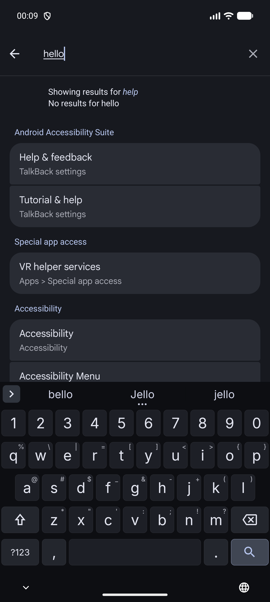
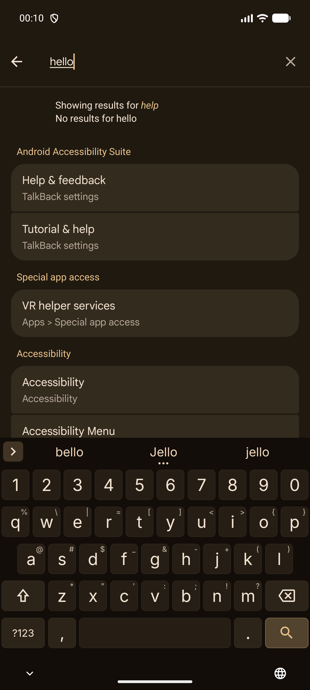
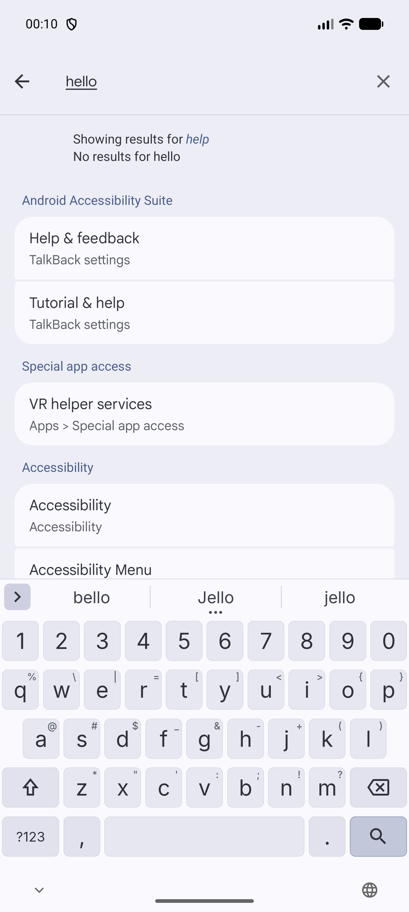
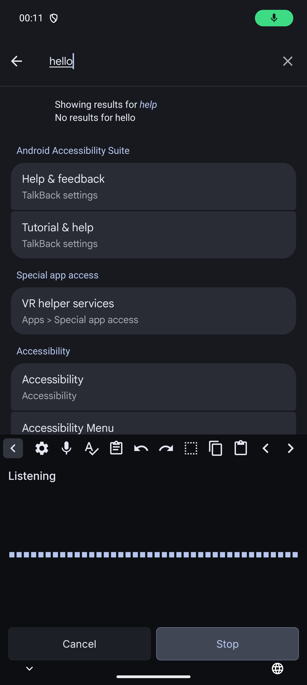
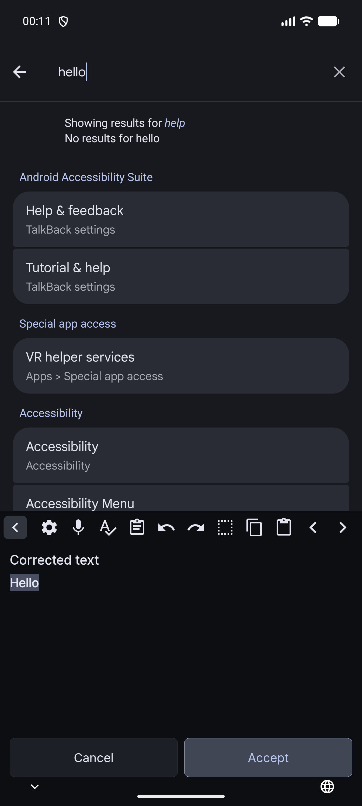
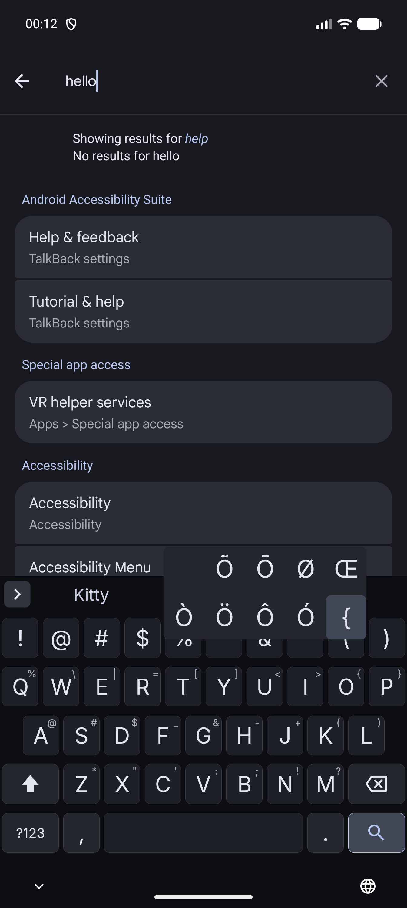

# Clackatoo

An offline Android keyboard with voice typing and a grammar check, based on
[HeliBoard](https://github.com/HeliBorg/HeliBoard) v4.2. Clackatoo has no `INTERNET` permission: typing, speech
recognition and grammar correction all run on the device.

| Dark | Dark, alternate palette | Light |
| --- | --- | --- |
|  |  |  |

| Voice typing | Grammar check | Popup keys |
| --- | --- | --- |
|  |  |  |

## Features

- **System theming.** Keys with 8dp corners and a hairline edge and Inter labels, coloured from the system's Material 3
  palette. The keyboard follows palette and dark-theme changes without a restart.
- **Themes.** A theme picker (Settings > Appearance > Theme) with live miniatures: Follow phone, three Glass themes
  (translucent, blurring the app behind the keyboard where Android allows it), all 23 colour themes of
  [Omarchy](https://github.com/basecamp/omarchy), HeliBoard's classic themes and your own, with separate day and night
  choices.
- **Glass settings.** The settings are frosted Material 3 panels over your wallpaper, which shows through the lightly
  tinted window (blurred on Android 12+ where the phone allows it, tinted more where it does not), with a "try it" field
  and quick buttons, a setup checklist that downloads the suggested models in one tap, tiles with the state of swipe
  typing, voice typing, grammar check and languages, theme swatches that apply a theme with one tap, and a
  "Glass background" switch for solid surfaces. Titles, headers and hints sit on frosted
  backings, never on the bare wallpaper. Every text surface keeps a contrast of at least 4.5:1 over any wallpaper, in
  light and dark mode, with and without blur.
- **Voice typing.** Speech to text with NVIDIA Parakeet TDT 0.6B v3 or, without it, Whisper (English and Spanish).
  With Parakeet the words appear in the voice panel while you speak and go into the field when you tap Stop. English
  transcripts are cleaned up by S1-mini by Superwhisper (filler words, self-corrections, punctuation, numbers).
- **Swipe typing.** Decoded on the device by the keyboard's own dictionary engine, with no closed-source library. In a
  host test on HeliBoard's gesture data it picks the intended word first for 82% of swipes and among the top three
  for 92% (Google's decoder: 86% and 96%). Settings > Gesture typing.
- **Grammar check.** Corrects the selection or the whole field with Qwen3.5 0.8B. Changes are shown highlighted and
  applied only when accepted.
- **Everything from HeliBoard.** Layouts, dictionaries, clipboard history, colour themes and the Material, Holo and
  Rounded styles.

## Installation

Clackatoo is distributed as two signed APKs on the [releases page](https://github.com/highlyproteus/clackatoo/releases):

| APK | App | Needs the internet |
| --- | --- | --- |
| `clackatoo-X.Y.Z.apk` | **Clackatoo**, the keyboard | No. It has no `INTERNET` permission. |
| `clackatoo-models-X.Y.Z.apk` | **Clackatoo Models**, an optional companion that downloads the voice and grammar models | Yes, only to download the pinned model files |

Install the keyboard, then enable it under Settings > System > Keyboard > On-screen keyboard. Install Clackatoo Models too if
you want one-tap model downloads (see [Models](#models)); without it you can import model files by hand.

Updates can be tracked with [Obtainium](https://github.com/ImranR98/Obtainium). Add the same repository URL twice,
`https://github.com/highlyproteus/clackatoo`, once for each app, and give each a different APK filter under "Filter APKs by
regular expression" (the app is identified by the APK it installs):

| App | Filter APKs by regular expression |
| --- | --- |
| Clackatoo | `^clackatoo-[0-9].*\.apk$` |
| Clackatoo Models | `^clackatoo-models-.*\.apk$` |

Each release lists both package names and the signing certificate (the same for both apps) for verification with
[AppVerifier](https://github.com/soupslurpr/AppVerifier).

### Models

The voice and grammar models are not bundled. Open Settings > Voice typing or Settings > Grammar check and tap Download
next to a model (or tap the Voice or Check key without a model and choose Download in the panel). The keyboard asks
Clackatoo Models to fetch it; Clackatoo Models downloads the exact file from Hugging Face, checks its size and SHA-256 and
hands it to the keyboard, which checks it again before it installs it. If Clackatoo Models is not installed the button reads
"Get Clackatoo Models" and opens this repository's releases page in your browser. Only small models are offered, so
they fit on a phone and run quickly; the starred ones are recommended:

| Role | Model | Maker, licence | Size |
| --- | --- | --- | --- |
| Voice typing, live text | Parakeet TDT 0.6B v3 (25 languages) ★ | NVIDIA, CC-BY-4.0 | 742 MB |
| | Parakeet TDT-CTC 110M (English, fast) | NVIDIA, CC-BY-4.0 | 143 MB |
| Voice typing | Whisper small ★ | OpenAI, MIT | 190 MB |
| | Whisper tiny, base | OpenAI, MIT | 32, 60 MB |
| English clean-up | S1-mini ★ | Superwhisper, Apache-2.0 | 484 MB |
| Grammar check | Qwen3.5 0.8B ★ | Qwen team, Apache-2.0 | 533 MB |

Every model is pinned by size and SHA-256 in `catalog/` (see [ml/README.md](ml/README.md) for the reference files and how
to import one by hand). The small Silero voice-detection model that Parakeet's live text needs ships inside the keyboard.

The model that suits your phone (its memory, CPU and your keyboard languages) is listed first and labelled "Suggested for
this phone"; you can still download and use any other. See "Which model for which phone" in [ml/README.md](ml/README.md).

#### Your own models (experimental)

Below the list, Settings > Voice typing and Grammar check have "Use your own model (experimental)" rows, behind a notice that
says plainly: not checked by Clackatoo, may not work, may be slow or use a lot of memory, results may be poor. Two ways in:
import any file from your storage (the keyboard finds the format from the file's header: Whisper `ggml-*.bin`, a Parakeet GGUF,
or a text GGUF that you use for clean-up or grammar; it refuses everything else, files over 4 GB and files that fail a test
load), or "Browse Hugging Face" in Clackatoo Models, where you type a search or `owner/name`, see the files and sizes, and pick
one. The keyboard sends the companion nothing for this. Custom models run in the same isolated process without internet, are
kept apart from the catalog models, are marked "Experimental · not verified", can be chosen like any model and deleted from
the card's menu. Text models are prompted with the chat template stored in the model file.

## Theming

The default colour theme, "Clackatoo (follows the phone)", maps keyboard elements to Material 3 colour roles:

| Element | Colour role |
| --- | --- |
| Keyboard background, suggestion strip | `surface` |
| Letter keys, space bar | `surfaceContainerHigh`, 1 px `onSurface` edge (12% dark, 16% light) |
| Function keys, popups | `surfaceContainerHighest` |
| Key labels, toolbar icons | `onSurface` |
| Hint letters, secondary text | `onSurfaceVariant` |
| Pressed and selected keys, active controls | `primary` |

Android 14 and later provide these roles directly; Android 12 and 13 use the nearest system tones, and earlier
versions use a fixed fallback palette. Labels are kept at a contrast ratio of at least 4.5:1, falling back to black or
white where a system colour would not meet it.

### Glass and Omarchy themes

The Glass themes make the keyboard window translucent: the gaps between the keys are clear glass, a light tint over
the blurred app behind, and every key, every suggestion and toolbar button, the emoji tabs and the voice panel's text sit
on a frosted backing (about 78% opaque, with a hairline) so that text never sits on the clear glass. On Android 12 and
later, where the phone allows window blur (not in battery saver, not switched off in developer options), what is behind
the keyboard is blurred; otherwise the clear parts get a heavier tint. The theme picker says which of the two applies
now. Whatever is behind the keyboard, every label keeps a contrast of at least 4.5:1 on its own backing (checked over
white, black, mid grey and saturated colours, in light and dark mode, with and without blur). The 23 Omarchy themes use the colour tables (`colors.toml`) of [Omarchy](https://github.com/basecamp/omarchy)
(MIT) at a pinned commit, mapped as: keyboard `background`; letter keys `lighter_background` (dark themes) or
`dark_background` (light themes); function keys `selection` or `darker_background`; labels `foreground`; hints
`light_foreground`; accent `accent`; labels and hints are raised to 4.5:1 where a theme is fainter. They are generated
by `python3 tools/omarchy-themes/generate.py` (needs network, or `--source` with a clone) into `OmarchyThemeData.kt`;
`--check` verifies the checked-in file.

## Privacy and security

- **No network access.** The keyboard does not request `INTERNET`; the release workflow fails if it appears. Downloads
  are done by the separate app Clackatoo Models, which asks for nothing but the network, a foreground service for the
  download and notifications (the workflow fails on any other permission). It accepts only the id of a model from its
  built-in catalog from the keyboard, never a URL, size or hash, follows redirects only to Hugging Face hosts, and
  hands the file over only to the keyboard. The two apps talk through a signature permission, so only apps signed with
  the Clackatoo key can use the link; the keyboard checks every file again before installing it.
- **Isolated model process.** whisper.cpp, parakeet.cpp and llama.cpp run in an isolated process
  (`android:isolatedProcess="true"`) with no permissions and no access to the keyboard's files. Models are passed as
  read-only file descriptors and all output is treated as untrusted.
- **Microphone.** `RECORD_AUDIO` is requested on first use of the Voice key. Audio is held in memory only, and
  recording stops when the voice panel is hidden. Voice and Check are disabled in password fields.
- **No external native code.** HeliBoard's option to load a user-supplied gesture-typing library is removed in every
  build type, so no third-party code runs inside the keyboard process. Swipe typing uses a decoder built into the
  keyboard instead (`app/src/main/jni/src/suggest/policyimpl/gesture/`, Apache-2.0).
- **Clipboard.** Clips marked sensitive (`android.content.extra.IS_SENSITIVE`) are not stored, and clipboard history
  is excluded from backups.
- **System-app installs.** When preinstalled in a ROM, the keyboard works before the first unlock while clipboard
  history, learned words and models remain in credential-protected storage.

## Building

Requirements: JDK 21, Android SDK (platform 37, build-tools 37.0.0), NDK `28.0.13004108`, CMake `3.31.6`.

```sh
git submodule update --init --depth 1   # whisper.cpp, llama.cpp and parakeet.cpp
git -C asr/native/parakeet.cpp submodule update --init --depth 1 third_party/ggml   # parakeet.cpp's ggml
./gradlew assembleDebugNoMinify         # debug build (io.github.highlyproteus.clackatoo.debug)
./gradlew assembleNouserlib             # release builds of the keyboard and Clackatoo Models, unsigned
./gradlew :app:testRunTestsUnitTest :models:testDebugUnitTest :catalog:testDebugUnitTest   # unit tests
```

Development notes are in [AGENTS.md](AGENTS.md).

## Releases

Releases are built and signed by the [Release workflow](.github/workflows/release.yml) when a `vX.Y.Z` tag matching
`versionName` in `app/build.gradle.kts` is pushed. The workflow verifies the package name, version, permissions and
signing certificate before publishing. Signing is configured once with `tools/make-release-key`.

## Upstream

`main` is HeliBoard v4.2 plus Clackatoo's changes. HeliBoard releases are merged from the `upstream` remote
(`https://github.com/HeliBorg/HeliBoard`). HeliBoard's original README, contribution guide and AI policy are kept in
[docs/](docs/HELIBOARD_README.md).

## License

GPL-3.0-only, as HeliBoard; see [LICENSE](LICENSE). Portions from AOSP are Apache-2.0
([LICENSE-Apache-2.0](LICENSE-Apache-2.0)), as are the swipe decoder's files in
`app/src/main/jni/src/suggest/policyimpl/gesture/`. The bundled Inter font is under the SIL Open Font License 1.1
([third_party/inter/OFL.txt](third_party/inter/OFL.txt)). Modifications to HeliBoard (GPL-3.0 section 5a) and
third-party notices are listed in [NOTICE](NOTICE).
